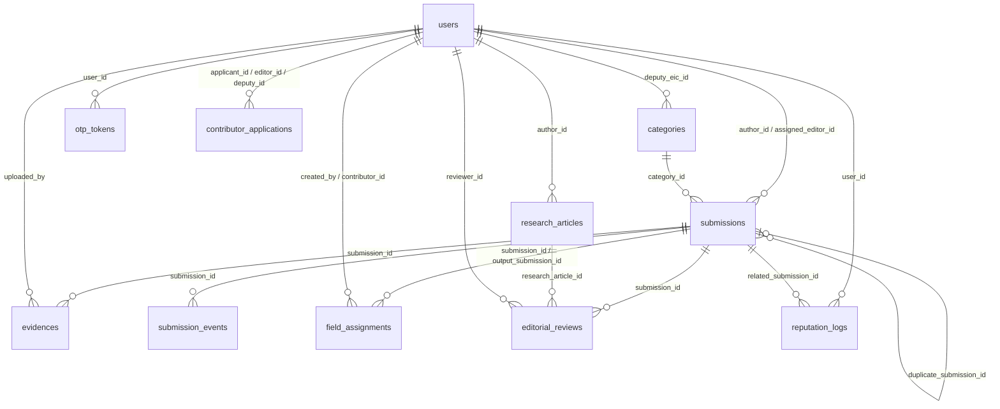

# Thiết kế cơ sở dữ liệu – Tin Nóng Dân Sinh

> Cập nhật theo các entity trong `citizen_journalism/src/main/java/.../entity/` (ngày 26/10/2026).
> Bảng do Hibernate tự tạo/cập nhật (`ddl-auto=update`) trên MySQL 8.

## Tổng quan

DB có đúng **11 bảng** (không tạo thêm bảng mới, chỉ được thêm cột):

| # | Bảng | Nguồn | Mục đích |
| --- | --- | --- | --- |
| 1 | `users` | Thiết kế | Tài khoản mọi vai trò |
| 2 | `categories` | Thiết kế | Chuyên mục / lĩnh vực |
| 3 | `submissions` | Thiết kế | Hồ sơ phản ánh: tin nóng, khiếu nại, phóng sự điều tra |
| 4 | `evidences` | Thiết kế | Tệp đính kèm của hồ sơ |
| 5 | `field_assignments` | Thiết kế | Nhiệm vụ giao CTV đi xác minh |
| 6 | `editorial_reviews` | Thiết kế | Mỗi thao tác của toà soạn trên hồ sơ / bài nghiên cứu |
| 7 | `reputation_logs` | Thiết kế | Lịch sử cộng / trừ điểm uy tín |
| 8 | `otp_tokens` | Bổ sung | Mã OTP (đăng ký, quên mật khẩu, đổi email) |
| 9 | `submission_events` | Bổ sung | Dòng thời gian xử lý hồ sơ (hiện cho người gửi) |
| 10 | `contributor_applications` | Bổ sung | Đơn đăng ký nâng cấp lên Cộng tác viên |
| 11 | `research_articles` | Bổ sung | Bài nghiên cứu của Chuyên gia |

### Quy ước chung

- Mọi bảng trừ `users` kế thừa `BaseEntity`: có `id BIGINT AUTO_INCREMENT` (PK), `created_at DATETIME NOT NULL`, `updated_at DATETIME` (Hibernate tự điền).
- Cột enum khai báo `@Enumerated(STRING)` + `length` được Hibernate tạo thành kiểu **`ENUM(...)`** của MySQL → thêm giá trị mới phải tự `ALTER TABLE`. Cột enum khai báo `columnDefinition = "VARCHAR(..)"` thì không gặp vấn đề này.
- Mật khẩu, mã OTP, mã PIN đều lưu dạng băm BCrypt.
- Ký hiệu cột Ràng buộc: **PK** khoá chính, **FK →** khoá ngoại, **NN** NOT NULL, **UQ** UNIQUE.

### Sơ đồ quan hệ

---

## 1. users

| Tên trường | Kiểu dữ liệu | Ràng buộc | Mô tả |
| --- | --- | --- | --- |
| id | VARCHAR(10) | PK | Mã người dùng = tiền tố vai trò + 4 số (ví dụ `CT0001`, `ED0001`, `AD0001`). Giữ nguyên khi đổi vai trò. |
| role | ENUM | NN | `CITIZEN` (CT), `CONTRIBUTOR` (CB), `EXPERT` (EX), `EDITOR` (ED), `DEPUTY_EIC` (DE), `EIC` (EC), `SYSTEM_ADMIN` (AD). |
| full_name | VARCHAR(255) | NN | Họ và tên. |
| email | VARCHAR(255) | NN, UQ | Email đăng nhập và nhận thông báo / OTP. |
| phone | VARCHAR(20) | NN | Số điện thoại. |
| username | VARCHAR(50) | UQ | Tên đăng nhập (không bắt buộc). Dùng cho Admin và tài khoản nhân sự do Admin tạo; người dân đăng nhập bằng email. |
| password_hash | VARCHAR(255) | NN | Mật khẩu đã băm BCrypt. |
| status | ENUM | NN | `PENDING_OTP` (chưa xác thực), `ACTIVE`, `LOCKED` (admin khoá). |
| is_verified | BOOLEAN | NN | Đã xác thực OTP hay chưa (mặc định `false`). |
| expertise_fields | TEXT | | Lĩnh vực chuyên môn (CTV / Chuyên gia). |
| credentials_file_data | LONGBLOB | | Cột theo thiết kế ban đầu, hiện chưa dùng (giấy tờ CTV lưu ở `contributor_applications.documents`). |
| credentials_files_meta | JSON | | Cột theo thiết kế ban đầu, hiện chưa dùng. |
| upgrade_status | ENUM | | Tóm tắt trạng thái nâng cấp CTV: `NONE` (mặc định), `PENDING`, `APPROVED`, `REJECTED`. |
| reputation_score | INT | | Điểm uy tín, mặc định 100 khi tạo tài khoản. |
| reward_points | INT | NN | Điểm thưởng tích luỹ, mặc định 0. |
| citizen_id | VARCHAR(20) | UQ | Số CCCD. |
| address | VARCHAR(255) | | Địa chỉ. |
| date_of_birth | DATE | | Ngày sinh. |
| avatar_url | VARCHAR(255) | | Đường dẫn ảnh đại diện. |
| failed_login_attempts | INT | NN | Số lần nhập sai mật khẩu liên tiếp, mặc định 0. |
| locked_until | DATETIME | | Khoá tạm đến thời điểm này do nhập sai mật khẩu nhiều lần (không đổi `status`). |
| created_at | DATETIME | NN | Thời điểm tạo tài khoản. |
| updated_at | DATETIME | | Thời điểm cập nhật gần nhất. |

## 2. categories

| Tên trường | Kiểu dữ liệu | Ràng buộc | Mô tả |
| --- | --- | --- | --- |
| id | BIGINT | PK | Mã chuyên mục. |
| name | VARCHAR(100) | NN | Tên hiển thị (Kinh tế, Pháp luật, Xã hội…). |
| slug | VARCHAR(100) | NN, UQ | Đường dẫn không dấu. |
| deputy_eic_id | VARCHAR(10) | FK → users | Phó Tổng biên tập phụ trách chuyên mục. |
| is_active | BOOLEAN | NN | Chuyên mục còn nhận bài hay không (mặc định `true`). |
| created_at | DATETIME | NN | |
| updated_at | DATETIME | | |

## 3. submissions

| Tên trường | Kiểu dữ liệu | Ràng buộc | Mô tả |
| --- | --- | --- | --- |
| id | BIGINT | PK | Mã hồ sơ nội bộ. |
| type | ENUM | NN | Loại nội dung: `HOT_NEWS`, `COMPLAINT`, `CONTRIBUTOR_POST`, `RESEARCH_PAPER`. |
| report_category | ENUM | | Loại người gửi chọn trên form: `HOT_NEWS`, `COMPLAINT` (Người dân / CTV / Chuyên gia), `INVESTIGATION` – phóng sự điều tra (chỉ CTV, lưu `type = COMPLAINT`). |
| category_id | BIGINT | FK → categories | Chuyên mục (BTV gán để điều tuyến tới đúng Phó TBT). |
| author_id | VARCHAR(10) | NN, FK → users | Người gửi. |
| assigned_editor_id | VARCHAR(10) | FK → users | Biên tập viên thụ lý. |
| title | VARCHAR(255) | NN | Tiêu đề. |
| summary | VARCHAR(300) | | Tóm tắt ngắn sự việc. |
| content | LONGTEXT | NN | Nội dung / diễn biến vụ việc. |
| incident_at | DATETIME | | Thời điểm xảy ra sự việc (không được ở tương lai). |
| province | VARCHAR(50) | | Tỉnh / thành nơi xảy ra. |
| address | VARCHAR(250) | | Địa chỉ cụ thể. |
| is_anonymous | BOOLEAN | NN | Gửi ẩn danh (mặc định `false`). |
| contact_name | VARCHAR(100) | | Họ tên liên hệ. NULL khi gửi ẩn danh. |
| contact_phone | VARCHAR(20) | | SĐT liên hệ. NULL khi gửi ẩn danh. |
| contact_email | VARCHAR(255) | | Email liên hệ. NULL khi gửi ẩn danh. |
| contact_citizen_id | VARCHAR(12) | | CCCD người gửi. NULL khi gửi ẩn danh. |
| reporter_relationship | ENUM | | Quan hệ với sự việc: `DIRECT_VICTIM`, `EYEWITNESS`, `LEGAL_REPRESENTATIVE`, `INDEPENDENT_EXPERT`. |
| tracking_code | VARCHAR(20) | UQ | Mã hồ sơ để tra cứu, dạng `KB-2026-0007`. |
| pin_hash | VARCHAR(100) | | Mã PIN tra cứu đã băm BCrypt. |
| pin_failed_attempts | INT | NN | Số lần nhập sai PIN, mặc định 0. |
| pin_locked_until | DATETIME | | Khoá tra cứu tạm thời do nhập sai PIN nhiều lần. |
| status | ENUM | NN | `PENDING`, `CANCELLED`, `IN_REVIEW`, `NEED_MORE_INFO`, `REJECTED`, `DEPUTY_PENDING`, `DEPUTY_REJECTED`, `EIC_PENDING`, `EIC_REJECTED`, `READY_FOR_PUBLISHING`, `PUBLISHED`, `CORRECTED`, `RETRACTED`. |
| priority | ENUM | | Mức ưu tiên: `LOW`, `MEDIUM`, `HIGH`, `BREAKING`. |
| impact_score | INT | | Điểm tác động xã hội do BTV đánh giá. |
| is_spam | BOOLEAN | | Cờ tin rác (mặc định `false`). |
| ai_summary | TEXT | | Tóm tắt tự động (chưa dùng). |
| duplicate_submission_id | BIGINT | FK → submissions | Trỏ tới hồ sơ gốc nếu bị trùng. |
| is_revealed | BOOLEAN | | Tổng biên tập đã giải mật danh tính bài ẩn danh hay chưa (mặc định `false`). |
| reveal_reason | TEXT | | Lý do giải mật. |
| created_at | DATETIME | NN | Thời điểm gửi. |
| updated_at | DATETIME | | |

## 4. evidences

| Tên trường | Kiểu dữ liệu | Ràng buộc | Mô tả |
| --- | --- | --- | --- |
| id | BIGINT | PK | Mã tệp. |
| submission_id | BIGINT | FK → submissions | Hồ sơ chứa tệp (cho phép NULL). |
| uploaded_by | VARCHAR(10) | NN, FK → users | Người tải lên. |
| file_url | VARCHAR(500) | NN | Đường dẫn tệp trong thư mục `uploads/`. |
| file_type | ENUM | | `IMAGE`, `VIDEO`, `AUDIO`, `DOCUMENT`. |
| metadata | JSON | | Thông tin tệp: `{"originalName","size","contentType"}`. |
| source_ref | VARCHAR(500) | | Nguồn / link trích dẫn. |
| created_at | DATETIME | NN | |
| updated_at | DATETIME | | |

## 5. field_assignments

| Tên trường | Kiểu dữ liệu | Ràng buộc | Mô tả |
| --- | --- | --- | --- |
| id | BIGINT | PK | Mã nhiệm vụ. |
| submission_id | BIGINT | NN, FK → submissions | Hồ sơ cần xác minh. |
| created_by | VARCHAR(10) | NN, FK → users | BTV giao việc. |
| title | VARCHAR(255) | NN | Tóm tắt yêu cầu nhiệm vụ. |
| assignment_mode | ENUM | NN | `BROADCAST` (mở cho mọi CTV) hoặc `DIRECT` (chỉ định). |
| contributor_id | VARCHAR(10) | FK → users | CTV nhận việc. |
| claimed_at | DATETIME | | Thời điểm CTV nhận việc. |
| output_submission_id | BIGINT | FK → submissions | Bài CTV gửi về sau khi tác nghiệp. |
| status | ENUM | NN | `OPEN`, `ASSIGNED`, `ACCEPTED`, `CANCELLED`, `COMPLETED`. |
| deadline | DATETIME | | Hạn hoàn thành. |
| created_at | DATETIME | NN | |
| updated_at | DATETIME | | |

## 6. editorial_reviews

Dùng chung cho hồ sơ phản ánh (`submission_id`) và bài nghiên cứu (`research_article_id`); mỗi dòng là một thao tác của toà soạn.

| Tên trường | Kiểu dữ liệu | Ràng buộc | Mô tả |
| --- | --- | --- | --- |
| id | BIGINT | PK | Mã lượt thẩm định. |
| submission_id | BIGINT | FK → submissions | Hồ sơ được thẩm định (NULL nếu là bài nghiên cứu). |
| research_article_id | BIGINT | FK → research_articles | Bài nghiên cứu được thẩm định (NULL nếu là hồ sơ). |
| reviewer_id | VARCHAR(10) | NN, FK → users | Người thao tác. |
| review_role | ENUM | NN | Vai trò khi thao tác: `EDITOR`, `DEPUTY_EIC`, `EIC`. |
| action | ENUM | NN | `REQUEST_INFO`, `APPROVE`, `REJECT`, `REQUEST_EDIT`, `ESCALATE`, `RETRACT`. |
| comments | TEXT | | Ý kiến, lý do từ chối, chỉ đạo. |
| content_snapshot | LONGTEXT | | Bản chụp nội dung tại thời điểm thao tác. |
| status | VARCHAR(20) | | Chỉ dùng cho `REQUEST_EDIT`: `PENDING` (chờ tác giả), `ACCEPTED`, `REJECTED`. |
| created_at | DATETIME | NN | |
| updated_at | DATETIME | | |

> Cả nhóm cần chạy 1 lần (ddl-auto không tự bỏ NOT NULL): `ALTER TABLE editorial_reviews MODIFY submission_id BIGINT NULL;`

## 7. reputation_logs

| Tên trường | Kiểu dữ liệu | Ràng buộc | Mô tả |
| --- | --- | --- | --- |
| id | BIGINT | PK | Mã biến động điểm. |
| user_id | VARCHAR(10) | NN, FK → users | Tài khoản được cộng / trừ điểm. |
| points_change | INT | NN | Số điểm thay đổi (dương: thưởng, âm: phạt). |
| reason | ENUM | NN | `INITIAL_CONTRIBUTOR_ONBOARDING`, `SUBMISSION_APPROVED`, `TASK_COMPLETED_ON_TIME`, `TASK_LATE`, `INACCURATE_EVIDENCE`, `SPAM_REPORTED`, `COPYRIGHT_VIOLATION`. |
| related_submission_id | BIGINT | FK → submissions | Hồ sơ liên quan. |
| created_at | DATETIME | NN | |
| updated_at | DATETIME | | |

## 8. otp_tokens

| Tên trường | Kiểu dữ liệu | Ràng buộc | Mô tả |
| --- | --- | --- | --- |
| id | BIGINT | PK | |
| user_id | VARCHAR(10) | NN, FK → users | Chủ sở hữu mã. |
| purpose | ENUM | NN | `REGISTER`, `RESET_PASSWORD`, `CHANGE_EMAIL`. |
| code_hash | VARCHAR(255) | NN | Mã OTP đã băm BCrypt. |
| expires_at | DATETIME | NN | Thời điểm hết hạn. |
| attempts | INT | NN | Số lần nhập sai, mặc định 0. |
| used | BOOLEAN | NN | Đã dùng hay chưa (mặc định `false`). |
| payload | VARCHAR(255) | | Dữ liệu kèm mã, ví dụ email mới khi `CHANGE_EMAIL`. |
| created_at | DATETIME | NN | |
| updated_at | DATETIME | | |

> Hệ thống chỉ kiểm tra mã **mới nhất** theo `user_id` + `purpose`.

## 9. submission_events

| Tên trường | Kiểu dữ liệu | Ràng buộc | Mô tả |
| --- | --- | --- | --- |
| id | BIGINT | PK | |
| submission_id | BIGINT | NN, FK → submissions | Hồ sơ. |
| status | ENUM | NN | Trạng thái hồ sơ sau sự kiện (cùng tập giá trị với `submissions.status`). |
| actor | ENUM | NN | Bên thực hiện: `REPORTER`, `SYSTEM`, `EDITOR`, `CONTRIBUTOR`, `DEPUTY_EIC`, `EIC`. |
| description | VARCHAR(255) | NN | Mô tả hiển thị trên dòng thời gian. |
| note | TEXT | | Ghi chú thêm cho người gửi. |
| created_at | DATETIME | NN | Thời điểm xảy ra sự kiện. |
| updated_at | DATETIME | | |

## 10. contributor_applications

Luồng: `PENDING_EDITOR` → `PENDING_DEPUTY` → `APPROVED`; kết thúc khác: `REJECTED` / `WITHDRAWN`.

| Tên trường | Kiểu dữ liệu | Ràng buộc | Mô tả |
| --- | --- | --- | --- |
| id | BIGINT | PK | Mã đơn. |
| applicant_id | VARCHAR(10) | NN, FK → users | Người dân nộp đơn. |
| status | ENUM | NN | `PENDING_EDITOR`, `PENDING_DEPUTY`, `APPROVED`, `REJECTED`, `WITHDRAWN`. |
| expertise_fields | VARCHAR(255) | NN | Lĩnh vực đăng ký. |
| province | VARCHAR(50) | NN | Tỉnh / thành hoạt động. |
| occupation | VARCHAR(100) | NN | Nghề nghiệp. |
| availability | ENUM | NN | Thời gian cộng tác: `FULL_TIME`, `PART_TIME`, `WEEKENDS`. |
| experience | TEXT | NN | Kinh nghiệm. |
| documents | JSON | | Giấy tờ: `[{"name","url","contentType","size"}, ...]`. Tệp ở `/uploads/applications/**`, chỉ xem qua API có kiểm tra quyền. |
| editor_id | VARCHAR(10) | FK → users | BTV xét duyệt bước 1. |
| editor_note | TEXT | | Ghi chú của BTV. |
| editor_reviewed_at | DATETIME | | Thời điểm BTV xét. |
| deputy_id | VARCHAR(10) | FK → users | Phó TBT xét duyệt bước 2. |
| deputy_note | TEXT | | Ghi chú của Phó TBT. |
| deputy_reviewed_at | DATETIME | | Thời điểm Phó TBT xét. |
| withdrawn_at | DATETIME | | Thời điểm người dân rút đơn. |
| created_at | DATETIME | NN | Thời điểm nộp đơn. |
| updated_at | DATETIME | | |

## 11. research_articles

Chỉ bài `DRAFT` mới sửa / xoá được.

| Tên trường | Kiểu dữ liệu | Ràng buộc | Mô tả |
| --- | --- | --- | --- |
| id | BIGINT | PK | Mã bài. |
| author_id | VARCHAR(10) | NN, FK → users | Chuyên gia viết bài. |
| status | ENUM | NN | `DRAFT`, `SUBMITTED`. |
| title | VARCHAR(250) | | Tiêu đề (≥ 10 ký tự khi nộp). |
| abstract_text | TEXT | | Tóm tắt (≥ 100 ký tự khi nộp). |
| field | VARCHAR(50) | | Lĩnh vực. |
| keywords | VARCHAR(255) | | Từ khoá. |
| content | LONGTEXT | | Nội dung (≥ 300 chữ khi nộp). |
| reference_list | TEXT | | Tài liệu tham khảo (tên cột tránh từ khoá `references` của MySQL). |
| has_conflict | BOOLEAN | | Có xung đột lợi ích hay không. |
| conflict_note | TEXT | | Giải trình xung đột lợi ích. |
| images | JSON | | Ảnh minh hoạ theo thứ tự: `[{"url","name","size","caption"}, ...]` (1–8 ảnh, mỗi ảnh ≤ 5MB). |
| submitted_at | DATETIME | | Thời điểm nộp. |
| review_status | VARCHAR(30) | | Trạng thái kiểm duyệt sau khi nộp: `DEPUTY_PENDING`, `REJECTED`. |
| priority | VARCHAR(20) | | Mức ưu tiên do toà soạn gán: `LOW`, `MEDIUM`, `HIGH`. |
| created_at | DATETIME | NN | |
| updated_at | DATETIME | | |
